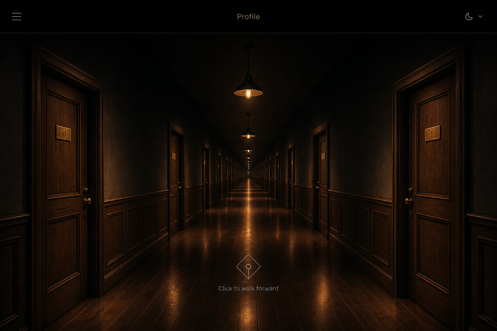

# 方案 A — CSS 3D 走廊（轻量，与 MechAssist 同源）



## 一句话

用 CSS `perspective` 搭出近大远小的走廊盒子，暖光用渐变和阴影「画」出来；点击中轴用 transform 把整条走廊往镜头方向推一档。栈与 [MechAssist-Fusion `extern-api`](D:/trae_git/MechAssist-Fusion/extern-api) 对齐。

## 技术栈（请确认）

| 层 | 选型 | 为何 |
| --- | --- | --- |
| 前端 | **Vite 5 + React 18 + React Router 6** | 与 `extern-api` 相同，单仓可复用工程习惯 |
| UI | **Tailwind CSS 3 + lucide-react**；走廊本体用 **自定义 CSS 3D**（不引入 Three.js） | mcp-gaode 已是 Dark Mode First（`#0B0F14`）；灯、木门用 CSS 渐变 / `box-shadow` |
| 状态 | **zustand** | 与 MechAssist 相同，存 `stopIndex`、房间列表 |
| 后端 | **Express 4 + better-sqlite3 + JWT** | 与 `extern-api/server` 相同：房间目录、门牌文案、后期房间正文 |
| 接口 | `GET /api/rooms`、`GET /api/rooms/:id` | 第一期也可先读本地 JSON，接口形状不变 |
| 动效 | CSS `transition` / 少量 `requestAnimationFrame` | 走廊沿 Z 前进约 600–900ms |
| 测试 / 构建 | Vitest + Vite build | 对齐 MechAssist |
| 部署 | `dist` 静态 + Express API；本机 `concurrently` 前后端 | 与 `npm run dev:all` 同一模式 |

**不选**：Three.js、Next.js、Vue。第一期把复杂度留在「透视走廊 + 点击前进」。

## 走廊怎么做

```
.scene { perspective: 800px; }
.corridor { transform-style: preserve-3d; transform: translateZ(cameraZ); }
  ├── .floor     rotateX(90deg)
  ├── .ceiling   rotateX(-90deg)
  ├── .wall-l    rotateY(90deg)
  ├── .wall-r    rotateY(-90deg)
  └── 每一对门：左右各一块木纹平面 + 门牌 label
灯：门楣上方暖色 radial-gradient，照亮墙下半与地面，上半墙叠一层向黑的遮罩。
```

点击中轴热区 → `cameraZ += 一档距离`（与门间距对齐），当前停驻点的左右门成为画面最大的一对。

## 优点 / 代价

- **优点**：包体小、无 WebGL 兼容问题、和现有仓库技术一致、改门牌只改数据。
- **代价**：灯光是「画」的，没有真实体积光和物理衰减；门很多时 DOM 面片会变多（可用只渲染附近 3～4 对门缓解）。

## 建议目录（选定后写入 `Code/`）

```
Code/
  src/pages/Profile/     走廊页
  src/components/corridor/  墙、地、灯、门、中轴热区
  src/store/corridorStore.js
  server/                Express + SQLite（可第二期再加）
```

## 适合谁

要尽快做出可点的走廊、并希望前后端写法与 MechAssist-Fusion 一致时，选 A。
