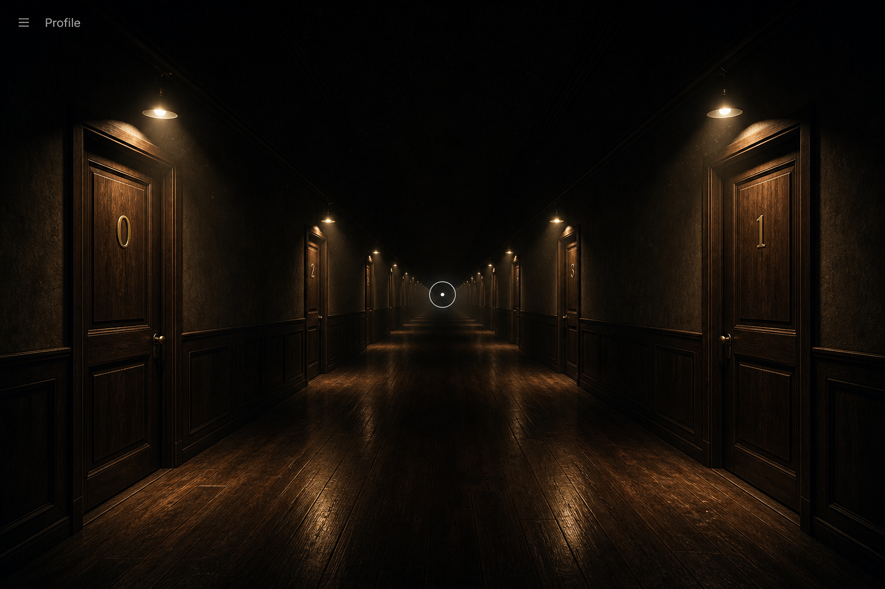

# 方案 B — Three.js 真 3D 走廊（最贴灯光描述）



## 一句话

走廊是真实 3D 场景：点光源挂在「天花与木门之间」，墙下半截被照亮、上半截自然变暗；点击中轴则把相机沿走廊 Z 轴平滑推到下一对门。前端仍用 Vite + React，只是场景层换成 WebGL。

## 技术栈（请确认）

| 层 | 选型 | 为何 |
| --- | --- | --- |
| 前端 | **Vite 5 + React 18 + React Router 6** | 与 MechAssist `extern-api` 同源 |
| 3D | **Three.js r16x + React Three Fiber + drei** | 业界最成熟的 React 3D 组合；`CameraControls` / `useFrame` 做前进 |
| UI | **Tailwind** 做 2D 覆盖层（标题 Profile、提示「点击走廊前进」、门牌也可做 HTML 标注） | 与 mcp-gaode 深色 HUD 同一思路 |
| 材质 | MeshStandardMaterial + 少量贴图（木门、地板、墙） | 暖色 `PointLight`，`decay` 控制只照到墙半截 |
| 状态 | **zustand** | `stopIndex` 驱动相机目标 Z |
| 后端 | **Express 4 + better-sqlite3** | 与方案 A 相同，房间数据不绑 3D 引擎 |
| 部署 | 同 MechAssist：Vite `dist` + Express | 注意开启 gzip，模型/贴图走静态目录 |

## 走廊怎么做

1. 沿 Z 轴重复「左门 + 右门 + 一盏暖灯」单元。
2. 每盏灯是 `PointLight`（色温约 2700K / `#ffb366`），位置在门楣与天花之间。
3. 墙用竖向渐变或两段材质：下半粗糙受光，上半 roughness 高、几乎无光照。
4. `fog` 让远端灭点融进黑暗。
5. 点击走廊地面中心（Raycaster 命中 floor 中带）→ 相机 `lerp` 到 `stopIndex + 1` 的观察点。

## 优点 / 代价

- **优点**：灯光、透视、近大远小是几何真实的，最接近你写的视觉；以后加开门动画、房间内景都在同一套相机里。
- **代价**：要处理模型/贴图、阴影性能、移动端 GPU；包体比方案 A 大；调试需要一点 3D 坐标直觉。

## 建议目录（选定后写入 `Code/`）

```
Code/
  src/pages/Profile/ProfileScene.jsx   R3F Canvas
  src/scene/Corridor.jsx               墙地天花
  src/scene/DoorPair.jsx               一对门 + 门楣灯
  src/scene/cameraStops.js             每个 stop 的相机坐标
  src/store/corridorStore.js
  public/textures/                     木纹、地板
  server/                              同方案 A
```

## 适合谁

把「暖灯只照半截墙 + 灭点走廊」当成主页气质的核心时，选 B。

---

## 已锁定修订（2026-09-07）

本方案被选为渲染与交互基底，但有三处按产品决定改掉原稿：

1. **灯**：改到 **走廊天花板中线**（方案 A），不再挂在门楣与侧墙之间。
2. **提示**：用方案 A 的 **文字**（`Click the corridor to walk forward`），删除地面圆圈/准星。
3. **后端 / 物理**：第一期都不做；物理与 Express 见 `Start/扩展模块_物理与后端.md`。

点门流程升级为：转身 → 再点铰链开门 → `/room/:id`。细节以 [Start](Start/README.md) 与 [door_Page](../door_Page/README.md) 为准。
