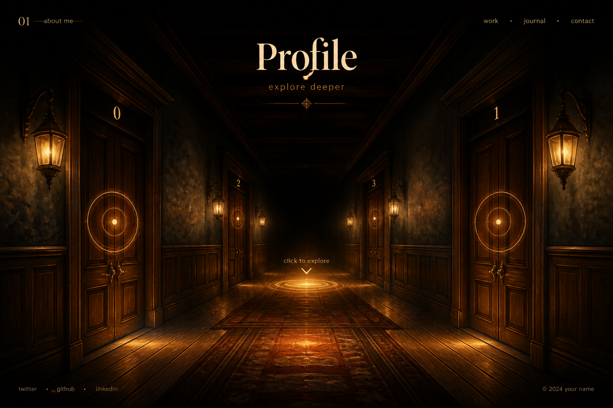

# 方案 C — 分层 2.5D 场景（最快做出氛围图）



## 一句话

不建 3D 盒子，而把走廊拆成几层图（地板光带、左右门、天花灯、暗角）叠在一起；点击中轴用 GSAP 做「拉近 / 切到下一对门」的缩放。第一期甚至可以几乎没有后端。

## 技术栈（请确认）

| 层 | 选型 | 为何 |
| --- | --- | --- |
| 前端 | **Vite 5 + React 18**（也可先纯 HTML 原型，再包进 React） | 仍与 MechAssist 同工具链，但 3D 引擎为零 |
| 动效 | **GSAP 3**（`scale` / `xPercent` 拉近下一停驻点） | 分层缩放最稳的成熟库 |
| UI | **Tailwind** + 热区（中轴前进、左右门） | 门牌用 HTML 叠在图上，改中英文零成本 |
| 视觉资产 | 分层 PNG/WebP（或 CSS 渐变模拟层） | 展示图气质可以最接近概念画 |
| 后端 | **第一期：静态 JSON**；第二期再 **Express + SQLite** | 个人资料页内容一开始往往很少，不必先上库 |
| 部署 | 纯静态也可（GitHub Pages / Nginx）；有 API 后再加 Express | 最轻 |

## 走廊怎么做

```
层从远到近：
  1. 灭点黑暗背景
  2. 远端门对（2/3 及更远）— 更小、更暗
  3. 当前门对（0/1）— 最大
  4. 地面光斑与中轴可点热区
  5. 天花暖灯光晕
点击中轴：当前层放大移出，下一对门层放大成为「当前」，stopIndex++。
```

门牌不是画死在图里，而是 HTML 绝对定位，方便以后改成中文名 / 英文名 / 数字。

## 优点 / 代价

- **优点**：出图最快，视觉可做成展示图那种电影感；无 WebGL；改文案容易。
- **代价**：前进是「拉近一层」而不是空间里走路，门对数一多就要补层或重复拼贴；灯光无法随视角连续变化。

## 建议目录（选定后写入 `Code/`）

```
Code/
  src/pages/Profile/ProfileLayers.jsx
  src/pages/Profile/hotspots.js    中轴 / 左门 / 右门点击区
  public/corridor/                 分层图
  src/data/rooms.json              第一期房间目录
```

## 适合谁

想先把主页「长得像那张图」并验证点击前进是否好用，房间内容还没定稿时，选 C。
